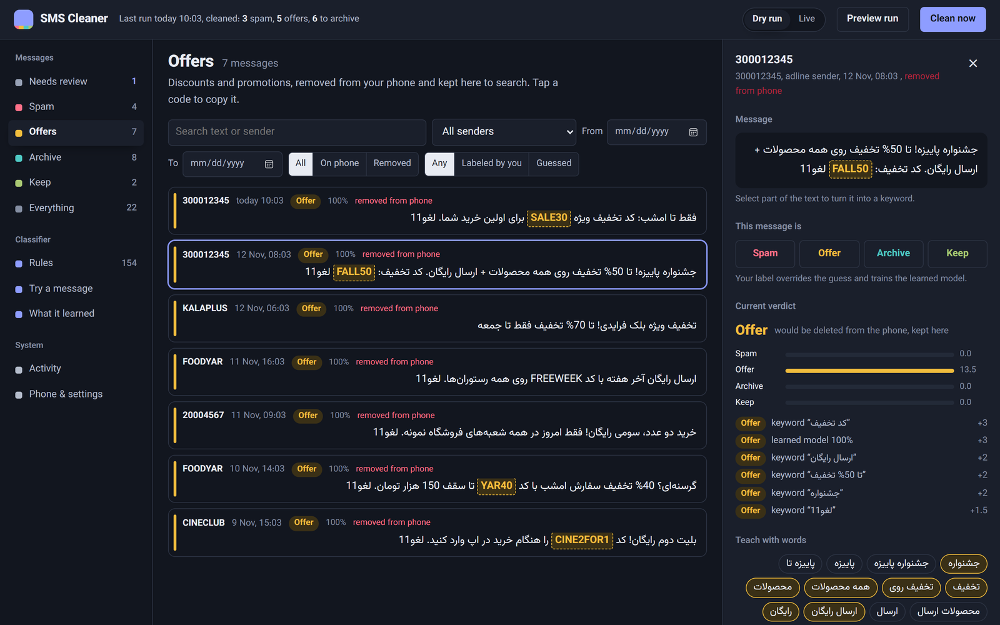
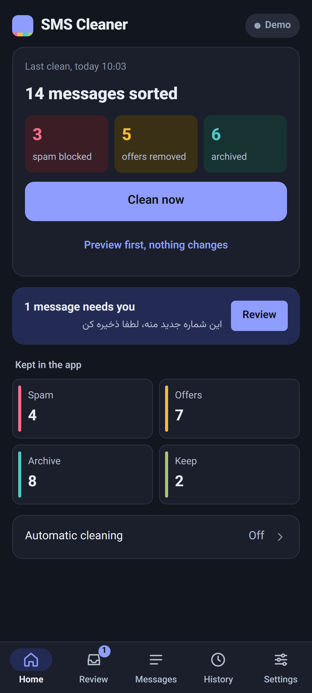
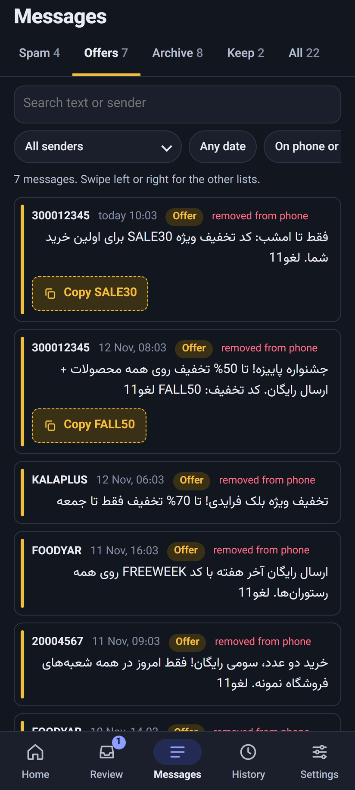
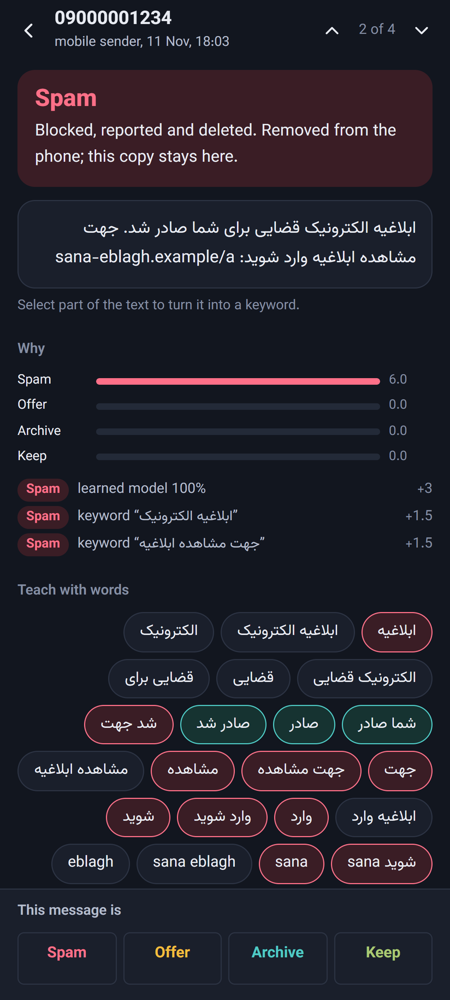
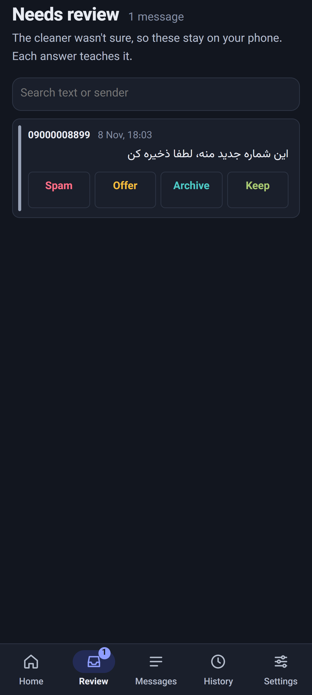
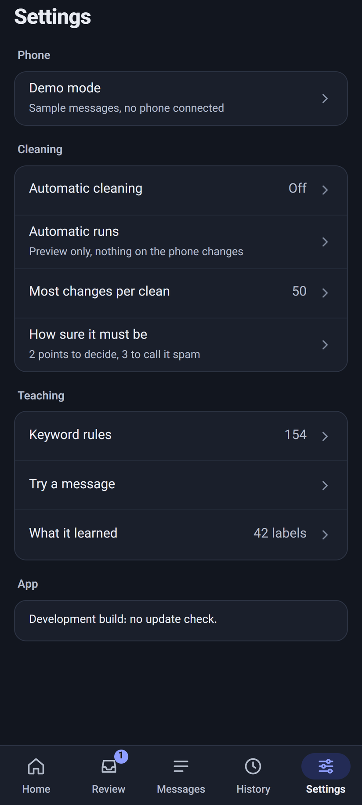
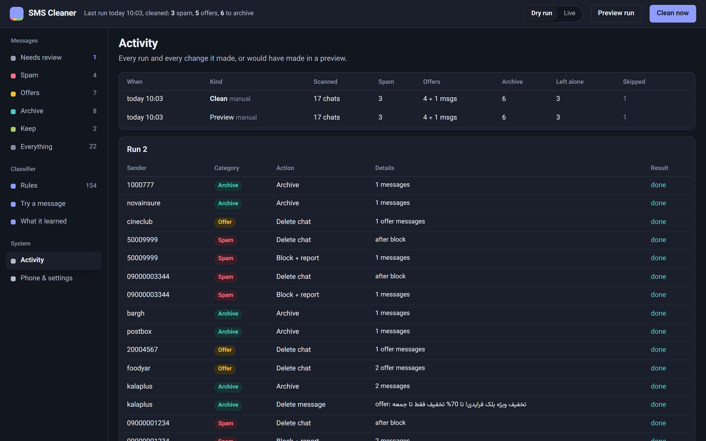

# sms-cleaner

Keeps the SMS inbox of an Android phone running **Google Messages** clean, on a schedule:

| The cleaner decides a message is… | What happens on the phone |
|---|---|
| **Spam** (phishing, scams, junk) | sender blocked and reported to Google, chat deleted |
| **Offer** (discounts, promotions) | deleted from the phone; a copy stays in the **Offers** list, searchable and filterable |
| **Archive** (banks, codes, deliveries, bills) | moved to *Archived* in Google Messages |
| **Keep** (written by a person) | nothing |
| **Unsure** | nothing; it waits in **Needs review** until you label it |

Never touched, never even read: **contacts**, group chats, pinned chats, and any chat you have replied to.
A run that cannot load your contact list stops instead of guessing.

It connects to your phone the way [messages.google.com/web](https://messages.google.com/web) does, using
[libgm](https://github.com/mautrix/gmessages/tree/main/pkg/libgm) from mautrix-gmessages. Nothing is
installed on the phone and Google Messages stays your SMS app.

## Screenshots

Sample data from demo mode (`SMSC_DEMO=1`): every sender, code and number below is made up.



<p>
  
  
  
</p>
<p>
  
  
</p>



## How it decides

1. **Rules** you can see and edit: *text contains*, *text matches pattern*, *sender is*, *sender matches pattern*.
   Each adds points to a category.
2. **A learned model** (naive Bayes over words, word pairs and sender type) trained on every message you label.
3. A message is decided when one category reaches 2 points and leads the next by 1. Spam needs 3 points,
   because spam gets blocked. Anything less certain is left alone.

It ships with 154 keyword rules mined from real Iranian SMS. The messages were labeled automatically, and a
keyword was kept only if it hit one category at least 90% of the time. `sms-cleaner eval` cross-validates
the classifier on your labeled data:

```
truth\got     spam    offer  archive     keep  unknown
archive          0        2      247        0        6
keep             0        1        3        9       12
offer            0      152       20        0        2
spam             1        2        0        0        1
decided 95% of messages; 93.6% of decided are correct; 3 would wrongly delete something worth keeping
```

## Teaching it

Open a message in the UI:

- **Label it** with Spam / Offer / Archive / Keep (or press `S` `O` `A` `K` in the review list). The model retrains immediately.
- **Tap the words that give it away.** Chips are tinted by the category the model already links them to.
  Pick some and save them as keyword rules. You can also select any part of the text.
- **Pin a sender** to one category. Prefer words for senders that mix codes and promotions (shops, banks).
- **Try a message** checks any pasted SMS and explains the verdict.
- **What it learned** shows the words the model leans on most, and imports more labeled examples
  (`.jsonl`, one `{"sender","body","label"}` per line) or rules (`.json` array).

## Run it

### Locally

```bash
go build -o sms-cleaner .
./sms-cleaner pair            # QR in the terminal (or `pair -google`); or pair from the web UI
SMSC_UI_PASSWORD=secret ./sms-cleaner serve   # http://localhost:8080
```

Try the UI without a phone: `SMSC_DEMO=1 ./sms-cleaner serve`.

### Docker (e.g. the Orange Pi arr stack)

```bash
cp .env.example .env    # set SMSC_UI_PASSWORD, optionally Telegram
docker compose up -d --build
```

Open `http://<host>:8085`, go to **Phone & settings** and pair:

- **Google account** (when Device pairing on the phone has no QR scanner): sign in at
  messages.google.com/web in a private window, copy the page request (DevTools › Network › Doc) as cURL,
  paste it, and tap the emoji the phone shows. Close the private window without signing out.
- **QR code**: Google Messages › profile › Device pairing › QR code scanner.

Then:

1. Press **Preview run** and look at **Activity**: it lists every change a real run would make.
2. Label what landed in **Needs review**.
3. Flip the header switch to **Live**. **Clean now** then changes the phone, at most 50 phone changes
   per run until you raise the limit.
4. The schedule is off until you set **Run every (minutes)** in **Phone & settings** (e.g. `360`).
   Scheduled runs follow the Dry run / Live switch.

Files put in `data/import/` (`*.jsonl` training, `*.json` rules) are imported on start and renamed `*.done`.

### On the phone itself (Android app)

`android/` wraps the same server in an app, so no PC or server is needed. On a phone-sized screen the
UI switches to a phone layout: a bottom bar (Home, Review, Messages, History, Settings), one big
**Clean now** on Home, label buttons right on the review cards, lists you swipe between, and messages
that open full screen with the label buttons pinned at the bottom.

The app starts the cleaner while you use it and stops it about a minute after you leave (a clean in
progress finishes first). **Automatic cleaning** (Settings › Cleaning) also works with the app closed:
Android checks about once an hour and the cleaner runs when the interval is due, following the
Preview only / Change the phone setting, then posts a summary notification. Every three days it also
connects once, because Google signs out Messages for web sessions that stay unused for about two weeks.

**Install:** download `sms-cleaner-<version>.apk` from the
[latest release](../../releases/latest) on the phone and open it (allow installs from your browser
when Android asks). Every push to `main` publishes a new signed release (`.github/workflows/build.yml`);
installing a newer APK updates the app in place and keeps its data.

**Updates:** the app checks GitHub for a newer release every few hours and shows a **Download**
banner when there is one; **Phone & settings › About** shows the installed version. To update
without opening the app, add this repository's URL to [Obtainium](https://obtainium.imranr.dev).

**Signing.** Releases are signed with one key, kept in the repository secrets `SMSC_KEYSTORE_BASE64`,
`SMSC_KEYSTORE_PASSWORD`, `SMSC_KEY_ALIAS` and `SMSC_KEY_PASSWORD`. Losing that key means the next
APK can't update the installed app (it would have to be uninstalled, which deletes its data), so keep
a backup of the keystore outside GitHub; secrets can't be read back.

**Build it yourself** (needs Go, JDK 17+ and the Android SDK; arm64 phones only):

```bash
cd android
./gradlew assembleDebug                   # app/build/outputs/apk/debug/app-debug.apk
adb install -r app/build/outputs/apk/debug/app-debug.apk
```

With `SMSC_KEYSTORE`, `SMSC_KEYSTORE_PASSWORD`, `SMSC_KEY_ALIAS` and `SMSC_KEY_PASSWORD` set, local
builds (debug ones too) are signed with the release key, so they install over a GitHub release and
back without losing data. Without them, a debug build needs the installed release removed first.

Coming from the PC or Docker version? `android/move-data.sh` copies your labels, rules, saved offers
and history into a debug build of the app. Add `--session` to move the pairing too (stop the PC
cleaner first; two cleaners can't share one pairing). The app turns off Android backup, since its
data includes your messages and Google cookies.

### Commands

```
sms-cleaner serve            web UI + scheduler (default)
sms-cleaner pair [-google]   pair by QR, or -google: cookies on stdin + emoji
sms-cleaner ping             connect once to keep an idle pairing alive
sms-cleaner tick             clean now if the schedule says one is due
sms-cleaner run [-live]      one pass; dry unless -live
sms-cleaner import FILE...   training .jsonl or rules .json
sms-cleaner eval [-v]        cross-validate; -v prints harmful mistakes
sms-cleaner export-rules     dump rules as JSON
```

### Environment

| Variable | Default | |
|---|---|---|
| `SMSC_DATA_DIR` | `./data` | SQLite DB, `session.json`, `import/` |
| `SMSC_LISTEN` | `:8080` | |
| `SMSC_UI_PASSWORD` / `SMSC_UI_USER` | empty / `admin` | Basic auth. Set it: the UI shows your SMS. |
| `SMSC_TELEGRAM_TOKEN`, `SMSC_TELEGRAM_CHAT_ID` | | summary after each live run, alert on failure |
| `SMSC_PROXY` | | `http://`, `https://` or `socks5://` proxy for Google traffic |
| `SMSC_DEMO` | | `1` = sample data, no phone |
| `SMSC_LOG_LEVEL` | `info` | |

## Things to know

- **The phone must be online.** Google Messages for web relays through it. The server stays connected
  between runs, which keeps Google-account cookies fresh; they expire if a session sits offline for long.
- **Google-account pairing stores Google cookies** in `data/session.json` (mode 600). Treat that file like a password.
- **One web session is active at a time.** While a run is connected, an open messages.google.com tab
  shows "use here". Runs connect, work for a minute or two, and disconnect.
- **The protocol is unofficial.** Google can change it; libgm (mautrix) usually catches up within days.
  Update with `go get go.mau.fi/mautrix-gmessages@latest` and rebuild.
- **Deleted is deleted on the phone.** The SQLite copy is the only one, so back up `data/`.
- **Archiving uses a request libgm doesn't name** (conversation action 4, captured from the
  messages.google.com web client). A status update to "archived" is acknowledged by the phone
  but does nothing. `sms-cleaner probe-archive CONVERSATION_ID` checks it against your phone.

## License

AGPL-3.0, because it links libgm (AGPL-3.0).
